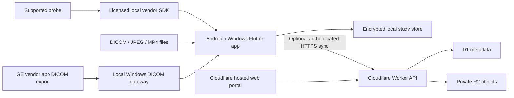

# Blue Ultrasound

Design proposal • 12 October 2026

## Product decision

Build installed Android and Windows applications for acquisition and local review, with Cloudflare hosting the web portal, API, and optional synchronized study storage. Cloud hosting cannot substitute for a local probe connection. Use Flutter for shared application screens, Kotlin/Java bridges on Android, and native C/C++ bridges on Windows where the selected manufacturer's SDK supports them. SDK availability must be checked per platform, probe model, firmware, and license.

Working assumptions: Blue is the provisional name and blue the provisional accent color; initial release is a research/education prototype using synthetic or reviewed de-identified studies. Exact GE model and intended clinical use are unresolved. Do not silently expand this to diagnostic use.

## Experience

Five screens: Workspace, Devices, Study viewer, Sync activity, Settings.

- Workspace: recent studies, new demo session, import scans, clearly stated local/cloud status.
- Devices: model, firmware, platform, integration type, verified capabilities, license requirements, connection status. Distinguish a supported SDK from a physically tested integration.
- Acquisition: full-size image, probe connection indicator, freeze/resume and capture controls only when the adapter reports support. Stale frames must show a prominent disconnected/stale state, never appear live.
- Viewer: study metadata, stills and cine playback; measurements remain unavailable until pixel spacing and geometry are validated. Preserve original DICOM files; JPEG/MP4 imports cannot assume clinical calibration.
- Sync: local-only is the default; user chooses which eligible studies to upload. Display pending, uploading, verified, failed, and deletion-pending states. Never display 'synced' before server receipt and integrity confirmation.

Android uses touch controls and bottom navigation; Windows uses a left navigation rail and keyboard-accessible controls. Use high-contrast neutral image surroundings, a blue navigation accent, 48 logical-pixel touch targets, visible focus, and text labels alongside status colors.

## Integration feasibility

| Source | First integration | Live acquisition status |
|---|---|---|
| GE Vscan Air | DICOM export through its vendor app to a local gateway; manual DICOM/JPEG/MP4 import | No public direct-probe SDK verified; request vendor access before promising control |
| Clarius | Evaluate Cast for live streaming through Clarius App; evaluate Solum for standalone operation | APIs documented; device license and platform support must be established and hardware tested |
| Butterfly | Evaluate requested developer SDK | Program exists; Android and Windows scope and redistribution terms unconfirmed |
| Other vendors | Import supported files, then evaluate an adapter | Unknown until model-specific evidence is available |
| Demo | Synthetic frame provider | Simulated only, unmistakably labeled |

DICOM export is not a live probe-control protocol. Broad brand support means a growing, tested compatibility matrix, not universal pairing. Do not label an unavailable adapter 'connected' or emulate unsupported controls.

## Architecture



Keep live image rendering and probe controls on the local device. Do not route live control through Cloudflare. A Windows gateway can receive DICOM C-STORE on a trusted LAN and upload eligible studies over HTTPS. Conventional DICOM listeners are not ordinary Worker HTTP endpoints. Gateway technology is an implementation decision after DICOM conformance review; evaluate established DICOM servers/libraries and their licenses before writing a receiver.

Cloudflare Workers serves the portal's static assets and TypeScript API. D1 holds users, organizations, permissions, study indexes, upload jobs, and audit events. R2 holds private original images and clips. No public buckets or permanent public study URLs. Start without live remote streaming, AI diagnosis, or remote probe controls.

### Adapter contract

Each adapter implements identify(), capabilities(), connect(), disconnect(), frames(), and connectionEvents(). Optional commands include setDepth(), setGain(), freeze(), resume(), and capture(). Capabilities are explicit, versioned, and disabled by default. Each frame includes session ID, monotonically increasing sequence, acquisition timestamp, dimensions, pixel format, orientation, calibration if available, and a source classification of simulated/imported/live. Preserve vendor metadata and units.

Use native texture/shared-buffer rendering for high-rate imagery after profiling; avoid serializing every frame through JSON platform channels. Bounded buffers favor recent frames; dropped frames and disconnects are reported. Android probe Wi-Fi may remove internet connectivity; offline operation is required and cloud uploads resume separately.

### Local storage and sync

Store original files with checksums plus a transactional study index and durable upload outbox. Protect local keys with platform-backed secure storage; select and validate database/file encryption packages before implementation. Separate users' caches and support explicit local retention/deletion.

Upload flow: create authorized upload job → upload bounded chunks/multipart objects → finalize with checksum and expected size → record verified state → expose in study lists. Use idempotency keys and resume after interruption. Never put patient names in object keys, URLs, logs, or telemetry. Enforce organization membership on every operation, including download, upload finalization, and deletion. Short-lived object URLs, if used, are bearer credentials and must not be logged.

Initial API resources: /v1/studies, /v1/studies/{id}, /v1/upload-jobs, /v1/upload-jobs/{id}/complete, /v1/studies/{id}/objects/{objectId}, /v1/studies/{id}/deletion, /v1/device-capabilities. Use pagination, explicit size/content limits, authorization, and structured errors. Cloudflare service limits and account quotas must be measured against representative cine studies before setting upload chunk sizes.

Portal rendering: the initial importer produces non-diagnostic PNG still previews and browser-compatible MP4 cine previews locally from supported inputs, preserving originals separately. Record derivative provenance, orientation, frame timing and conversion version. Validate target browser codecs with fixture files; an unsupported original may be retained but must show 'Preview unavailable', never a misleading blank/success state. Diagnostic browser viewing is outside this initial release. Step 3 owns conversion fixtures; step 5 verifies browser playback and unsupported-format behavior.

Deletion wins over stale uploads: server-side study versions and deletion tombstones reject late finalization and stale client writes. Keep tombstones for the supported offline window and require full reconciliation from clients older than that window. Sweep abandoned multipart uploads and unreferenced objects after a defined grace period. Step 4 must test deletion during an upload, late retries from offline clients, cleanup, and restore/export policy so deleted studies cannot silently reappear.

Gateway ownership: pair each gateway to an authenticated organization and authorized operator. Incoming studies enter a local quarantine queue until an operator confirms organization and study/session association; ambiguous or missing patient identifiers cannot trigger automatic matching. DICOM tags, AE titles and source addresses never establish cloud tenant ownership. Step 7 verifies mismatched identifiers, duplicate identifiers and unassigned imports before enabling forwarding.

Use an OIDC identity provider with Authorization Code + PKCE for installed apps; never embed confidential client secrets. Web sessions use secure HttpOnly cookies with CSRF protection. D1 stores authorization relationships, not passwords. Define roles initially as administrator, researcher, and viewer.

### Data boundaries

Prototype uses synthetic data. If using de-identified exports, check both DICOM metadata and burned-in image text; stripping tags alone is insufficient. Enabling identifiable patient data requires a separate clinical/privacy readiness milestone: confirm contracts and exact Cloudflare services covered by the applicable BAA, regional requirements, retention, access auditing, incident response, and intended-use validation. Do not assume a Cloudflare account automatically makes this architecture HIPAA compliant. Unconfirmed services are excluded from PHI paths until verified.

## GitHub and licensing

Proposed monorepo:

```text
apps/client/                 Flutter Android + Windows
apps/portal/                 browser study workspace
services/api/                Cloudflare Worker
packages/adapter-contract/   protocol and conformance fixtures
adapters/demo/               synthetic source
adapters/clarius/            optional licensed SDK integration
services/dicom-gateway/      local Windows ingest
infra/                      Wrangler configuration and migrations
docs/                       compatibility, security, contributor guides
design/                     reviewable UI concepts
```

GitHub stores code, documentation, issues, and releases; never patient studies or vendor credentials. CI runs Android and Windows builds, adapter contract tests, authorization tests, and Worker checks. Native releases require signing and separate protected credentials. Proprietary SDKs are fetched only where permitted and are excluded from public source bundles. Ship an open-source build with demo/import capabilities independently of proprietary adapters. Apache-2.0 is proposed for our original code, not a license grant over vendor components.

No repository owner/name has been selected. This workspace is not currently a Git checkout; git is installed, gh is unavailable. Work in local files now. When a GitHub target is selected, implement each step as a branch and reviewed PR using the available connector or Git tools.

## Construction plan

Verification below names intended acceptance checks, not commands that already exist. Each implementation PR must add reproducible commands to its README and CI before closing. Flutter baseline: flutter analyze; flutter test; flutter build apk --debug; flutter build windows on a Windows runner. Worker baseline after setup: npm ci; npm run typecheck; npm test.

### 1. Establish project and offline demo (default model)
Context: no native code exists; support Android and Windows without a probe or cloud account. Create Flutter scaffold, navigation, synthetic adapter, explicit demo state, license and contribution docs. Verify both platforms build and demo remains usable with networking disabled. Exit: reproducible builds and labeled simulated acquisition. Rollback: revert scaffold; preserve design documents. Dependencies: none.

### 2. Define adapter and image lifecycle (strongest model)
Context: core UI must not depend on a vendor library. Add versioned capability schema, state machine, frame metadata and bounded rendering pipeline. Test unsupported commands, stale frames, disconnect/reconnect, invalid dimensions, and missing calibration. Exit: demo passes contract tests; disconnected imagery cannot be mistaken for live. Rollback: revert new interface and demo implementation together. Dependencies: 1.

### 3. Implement local study import and storage (default model)
Context: GE can initially contribute exported files; direct GE control is unverified. Add DICOM/JPEG/MP4 import with validated parser limits, cine review, checksum, encrypted storage and retention. Test representative single/multiframe files, corrupt input, oversized input, unsupported transfer syntaxes, absent calibration, and local deletion. Exit: supported-format matrix and fixtures without PHI; unsupported files produce clear errors. Rollback: disable importer and retain originals for recovery. Dependencies: 2.

### 4. Build Cloudflare sync and identity (strongest model)
Context: local acquisition must survive absent internet. Implement OIDC sessions, organization checks, Worker API, D1 migrations, private R2, outbox and upload finalization. Test cross-tenant denial, expired credentials, interrupted upload, duplicate finalization, hash mismatch and partial deletion recovery. Exit: two test tenants cannot access each other's synthetic studies and interrupted transfers recover. Rollback: disable synchronization, keep local copies; never assume Worker rollback reverses D1/R2 state. Dependencies: 3.

### 5. Build hosted study portal (default model)
Context: cloud portal reviews synchronized studies; it does not connect directly to probes. Implement searchable study list, authorized viewer, access settings and sync/deletion state. Check keyboard navigation, contrast, narrow layouts, inaccessible study links and logged-out access. Exit: synthetic studies accessible only to authorized members, no public object leaks. Rollback: return portal to previous version while keeping API/data compatible. Dependencies: 4.

### 6. Prove first live adapter (strongest model)
Context: SDK and physical hardware required; choose the available licensed device, provisionally Clarius. Obtain access, verify platform matrix and redistribution terms, then bridge native streaming/control. Test on each claimed OS/model/firmware: connect, freeze, capture, reconnect, Wi-Fi changes, frame latency, calibration and command limits. Exit: signed-off compatibility record with hardware results; unsupported platforms remain explicitly unavailable. Rollback: feature-disable adapter, retain demo/import. Dependencies: 2 plus hardware/SDK access. Can proceed alongside 3–5 in adapter-owned files.

### 7. Add GE DICOM gateway (strongest model)
Context: exact Vscan Air model and software must be confirmed; the GE app exports to a local receiver. Configure selected gateway and supported DICOM services based on GE conformance documents; add authenticated local ingest and optional sync. Restrict listener to configured private interfaces and known sources; apply application-level authorization separately because an AE title is not strong authentication. Verify real GE export, multiframe preservation, duplicates, unsupported objects and offline retry. Exit: documented tested GE workflow without claiming direct-probe control. Rollback: disable gateway and use manual import. Dependencies: 3; cloud forwarding also requires 4; hardware required.

### 8. Package research release (default model)
Context: only tested capabilities can appear in release notes. Add native signing workflow, installer/update documentation, versioned compatibility matrix, dependency license inventory, recovery/export instructions and security contact. Run all preceding applicable checks and install on clean Android and Windows systems. Exit: tagged research release with honest unsupported-device list. Rollback: withdraw affected release and restore prior signed version; document storage compatibility. Dependencies: 5, and 6/7 only for integrations included in release. Clinical deployment remains a separate scope.

Dependency graph: 1 → 2 → 3 → 4 → 5 → 8; 2 → 6 → 8 if shipping live support; 3 → 7 → 8 if shipping GE gateway. Step 6 is the main parallel workstream. Do not block a demo/import-only release on inaccessible SDKs.

Plan changes: record date, reason, affected steps and evidence here; revise dependencies, acceptance criteria and compatibility claims together. Never convert a blocked hardware milestone into a completed integration by substituting simulation.

## Sources and open decisions

- [Flutter supported platforms](https://docs.flutter.dev/reference/supported-platforms) and [native integration](https://docs.flutter.dev/platform-integration/platform-channels).
- [Cloudflare web application architecture](https://developers.cloudflare.com/use-cases/web-apps/) and [static asset routing](https://developers.cloudflare.com/workers/static-assets/binding/).
- [Cloudflare HIPAA whitepaper](https://www.cloudflare.com/resources/assets/slt3lc6tev37/3PeVHvuZAh7p3tN77kIfhG/596a459dd1cfbc2ad6b1dbef36ff0eb1/BDES-1265_Privacy_Compliance_Whitepapers_HIPAA.pdf): background on BAAs, not confirmation that this proposed service combination is covered.
- [GE Vscan Air SL specifications](https://www.gehealthcare.com/-/jssmedia/gehc/us/files/products/ultrasound/handheld-ultrasound/doc3067867_vscanairsl_datasheet_r3_2025_final.pdf).
- [Clarius developer portal](https://github.com/clariusdev) and [Cast](https://github.com/clariusdev/cast).
- [Butterfly developer program](https://www.butterflynetwork.com/ai-developers).

Open decisions: meaning of “for blue”; exact GE device/firmware; research vs patient-facing use; SDK/hardware access; GitHub owner/repository and Cloudflare account/domain; identity provider; PHI service eligibility if needed.

Review record, 12 October 2026: independent Blueprint review found no critical feasibility or device-claim issues. Incorporated its three findings: explicit portal derivative/codec strategy, gateway assignment quarantine, and delete-versus-upload conflict handling. This is a reviewed proposal; hardware and application behavior have not been validated.
